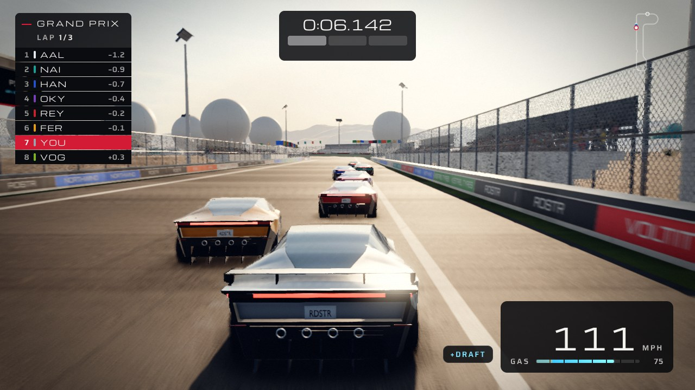

# Voltitude

A thruster stunt racer for the browser, built around the 2026 Tesla Roadster. Fans hold the car to walls and loops. Four rear nozzles boost it, four down thrusters hop and hover it, and two side thrusters steer it in the air. The fastest line on every lap goes through the air.



## Play

The game is plain ES modules with no build step. Serve the repo root and open it in a WebGL2 browser:

```sh
npm start
```

Then open http://localhost:8790/.

## Controls

| Action | Keyboard | Gamepad |
|---|---|---|
| Throttle, brake | W, S (or arrows) | RT, LT |
| Steer | A, D (or arrows) | Left stick |
| Boost (rear thrusters) | Left Shift | B or X |
| Hop, hover (down thrusters) | Space | A |
| Air roll | Q, E | LB, RB |
| Back to checkpoint | Backspace | |
| Restart | R | |

In the air, throttle and brake tilt the nose and steering yaws the car. Steer while hovering to strafe. Every key can be rebound in the garage.

## What's in it

- **Three venues.** Proving Ground is a high-desert circuit with a loop, a 55° wall-ride and two air lines. Airfield runs down a dry-lakebed runway and through the hangars. Launch Complex is a coastal rocket pad with a 50° wall-ride round the tank farm and a climb past the launch tower.
- **Three events per venue.** A three-lap Grand Prix against seven rivals, a time trial against your ghost or the author's, and practice.
- **Gas is earned, not refilled.** Near misses, air time, clean landings, wall-rides, drafting and flight gates fill the tank.
- **Rivals with character.** Each driver has their own pace, nerve and racecraft. They take air lines, miss landings and defend the inside. There are three difficulty tiers and no rubber-banding.
- **Track limits, Forza style.** Gaining time with four wheels past the white line costs that time back in a race, or the lap in a time trial. Flying over the infield is always legal.
- **Day and night.** Golden-hour desert or floodlit night, with a festival crowd, fireworks and a drone show.

URL options for testing: `?venue=proving|airfield|launch`, `&event=gp|tt|pr`, `&autostart`, `&autopilot` (a bot drives), `&day` or `&night`.

## Develop

```sh
npm test                               # sim tests, node --test
node tools/exploits.mjs proving        # exploit patterns against one venue
node tools/ai-bench.mjs 20 proving     # seeded races per difficulty tier
node tools/bake-terrain.mjs proving    # after any layout change; tests fail on a stale bake
node tools/medals.mjs                  # author ghosts and medal times
```

The browser tools (`shot-match`, `menu-shots`, `capture-gates`, `perf`) drive system Chrome through Playwright. Install them once with `npm install --prefix tools`.

| Path | What lives there |
|---|---|
| `src/sim/` | Deterministic 120 Hz simulation: car physics, circuits, race rules, AI drivers, track limits |
| `src/render/` | three.js rendering, one module per concern |
| `src/` | Entry point, HUD, menu, input and audio |
| `rl/` | Vendored three.js r169 and the procedural music engine |
| `assets/` | Car model, terrain bakes, sky, audio, crowd, author ghosts |
| `tools/` | Bakes, benchmarks, capture harnesses, the Blender car build |
| `docs/` | Design, research, plans and before/after contact sheets |

`progress.md` is the running development log.

## Credits

- Sky HDRIs: [Poly Haven](https://polyhaven.com) (CC0). Terrain materials and boulders: CC0 texture and scan sets.
- Crowd characters and animation: Quaternius Universal Base Characters and Universal Animation Library (CC0).
- Sound: Freesound recordings, some CC BY 4.0. Every source, author and licence is in [`assets/audio/CREDITS.md`](assets/audio/CREDITS.md).
- The Roadster model is built procedurally in Blender by `tools/car/`.
- 3D engine: [three.js](https://threejs.org) (MIT).

Voltitude is a fan project. It is not affiliated with or endorsed by Tesla, Inc. "Tesla" and "Roadster" are trademarks of their owner.

## License

Code is [MIT](LICENSE). Third-party assets keep the licences listed above.
